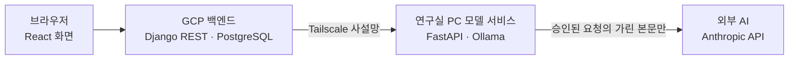

# 마스크 어시스턴트 (Mask Assistant)

> AI로 일하되, 무엇을 보내는지 확인하도록.

개발팀과 보안팀을 따로 두기 어려운 중소 제조기업을 위한 AI 동료입니다. 직원이 외부 AI에 일을 맡기기 전에 요청을 먼저 검사해 거래처명, 사업명, 사람 이름, 연락처, 금액 같은 민감정보를 가리고, 직원이 가린 결과를 확인한 뒤에만 외부 AI로 보냅니다. 외부 AI의 답변은 원래 값으로 되돌려 돌려주고, 대외비 문서는 밖으로 보내지 않고 사내 모델이 답합니다. 모델은 8GB GPU를 단 PC 한 대에서 돌아가고, 직원·관리자 화면까지 갖춘 완성형 웹 서비스라 개발 없이 설치해 씁니다. AI가 먼저 검사하고, 보낼지는 사람이 정합니다.

충북대학교 2026 AI 우왕톤 3팀 **초코 츄러스**의 프로젝트입니다. 이 문서 앞부분은 프로젝트 전체 소개이고, 뒷부분은 이 저장소(프론트엔드) 설명입니다.

| 항목 | 링크 |
| --- | --- |
| 서비스 | https://chochu.certcbnu.kr |
| 테스트 계정 | 최종 제출 폼 참고 |
| 시연 영상 | 제출 전 추가 |
| 팀 Notion | 제출 전 추가 |
| 저장소 | [FE](https://github.com/woowangthon/WOOWANGTHON_TEAM_03_FE) (이 저장소) · [BE](https://github.com/woowangthon/WOOWANGTHON_TEAM_03_BE) · [AI](https://github.com/woowangthon/WOOWANGTHON_TEAM_03_AI) |

## 1. 문제

### 누가 겪는 문제인가

- 대상은 외부 생성형 AI 사용이 제한된 방산 협력업체 같은 중소 제조기업의 직원과 보안 관리자입니다.
- 직원은 보고서 번역이나 긴 문서 요약에 AI를 쓰고 싶습니다. 그런데 그 문서에는 거래처, 담당자, 금액이 함께 들어 있습니다.
- 회사는 기밀이 든 문서를 외부 AI에 그대로 보내도록 허용하기 어렵습니다. 그래서 외부 AI 사용을 금지합니다.
- 금지만으로는 문제가 사라지지 않습니다. 마감에 쫓긴 직원은 기밀보고서 원본을 외부 AI에 그대로 올리게 됩니다.
- 중소기업은 큰 기업처럼 보안 솔루션을 연동하거나 사내 AI를 따로 개발할 인력과 예산을 두기 어렵습니다. 그래서 개발 없이 설치해 바로 쓰고, 담당자 한 명이 관리할 수 있어야 합니다.

### 근거

| 근거 | 출처 |
| --- | --- |
| 지식 근로자의 75%가 업무에 생성형 AI를 사용 | Microsoft·LinkedIn, 2024 Work Trend Index (31개국 31,000명) |
| AI 사용자의 78%가 회사가 제공하지 않은 AI 도구를 직접 가져와 사용 | 같은 조사 |
| 69%가 금지된 AI 사용을 의심 | Gartner, 2025-11-19 |
| 업무용 컴퓨터의 생성형 AI 사용 차단 요구 | 방위사업청 개선 공고 |
| 정보보호 업무를 하는 기업 중 정보보호 조직을 둔 곳 35.3%, 정보보호 예산을 쓰는 기업 54.8% | 과기정통부·한국정보보호산업협회, 2025 정보보호 실태조사 (종사자 10인 이상 5,500개 기업, [바이라인네트워크 보도](https://byline.network/2026/03/27-592/)) |

AI를 쓰려는 수요는 이미 크고, 금지해도 몰래 쓰는 일이 생깁니다. 그런데 정보보호 업무를 하는 기업 중에서도 정보보호 조직을 둔 곳은 35.3%입니다. 막기만 하는 대신, 보안 인력이 적은 회사도 설치해서 안전하게 쓰는 방법이 필요합니다.

## 2. 해결 방법

1. 직원은 평소처럼 요청문을 쓰고 PDF를 첨부합니다.
2. 모델 서비스가 요청문과 PDF 본문을 함께 검사해 가릴 구간을 찾습니다.
3. 정책 규칙이 처리 경로를 정합니다. 사내 처리, 외부 처리, 차단 중 하나입니다.
4. 외부 처리라면 직원이 가릴 구간을 확인하고 승인해야 보냅니다. 30분 안에 승인하지 않으면 만료되고 보내지 않습니다.
5. 외부 AI는 자리표로 바뀐 본문만 받습니다. 답변 속 자리표는 사내에 보관한 대응표로 원래 값을 되돌립니다.
6. 관리자는 요청, 검사 결과, 승인, 전송 이력과 통계를 봅니다. 직원의 AI 답변은 관리자에게 보여 주지 않습니다.

| 정보 유형 | 원문 | 외부 AI에 보내는 값 |
| --- | --- | --- |
| 회사명 | 한빛에어로 | `[[ORG_1]]` |
| 사람 이름 | 김지영 | `[[PERSON_1]]` |
| 금액 | 2,400,000원 | `[[AMT_1]]` |

원문과 자리표의 대응표는 내부 DB에 보관하며 외부 AI에 보내지 않습니다. 예시 문서는 가상 데이터입니다.

| 처리 경로 | 언제 | 결과 |
| --- | --- | --- |
| 사내 처리 | 내부 전용 문서(대외비, 외부 공유 금지 등)이거나 사내 모델로 충분할 때 | 가리지 않고 연구실 PC의 로컬 모델이 답변 |
| 외부 처리 | 고성능 외부 AI가 필요할 때 | 가림과 직원 승인 뒤 외부 AI가 답변하고 원래 값으로 복원 |
| 차단 | 문서 통째 유출, 개인정보 묶음 수집 같은 요청 | 답변을 만들지 않고 기록만 남김 |

## 3. 기존 방식·서비스와 비교

기존 방식은 외부 AI를 막아 일을 못 하게 하거나, 원문을 그대로 보내거나, 개발팀이 있어야 쓸 수 있습니다. 마스크 어시스턴트는 설치해서 바로 쓰고, 대외비 문서는 사내 모델로 처리하고, 나머지는 가린 뒤 직원이 확인하고 보냅니다.

| 기준 | ChatGPT Enterprise | 파수 AI-R DLP | Skyflow | **마스크 어시스턴트** |
| --- | --- | --- | --- | --- |
| 회사 안에 설치 가능 | ❌ OpenAI 클라우드 | ❌ | ❌ 클라우드 배포만 | ✅ |
| 대외비 문서를 밖으로 보내지 않고 AI 사용 | ❌ 원문 전송 | ❌ 차단 또는 가린 본문 전송 | ❌ 가린 본문 전송 | ✅ 사내 모델이 답변 |
| 개발팀 없이 바로 사용 | ✅ | ✅ | ❌ API 연동 필요 | ✅ |
| 보내기 전 직원 확인 | ❌ | ❌ 관리자 알림만 | ❌ | ✅ |
| 가린 뒤 답변을 원래 값으로 복원 | ❌ 가리지 않음 | ❌ | ✅ | ✅ |
| **한 줄 요약** | 원문 외부 전송 | 차단, 또는 복원 없는 가림 | 개발 필요, 본문 외부 전송 | **설치 즉시 사용, 대외비 사내 처리** |

다른 서비스는 아래 출처의 공개 자료 기준이며, 마스크 어시스턴트의 시연 구성은 GCP 서버와 연구실 PC입니다.

### 차별점

가려서 보내고 답변을 원래 값으로 되돌리는 방식은 Skyflow 같은 서비스도 제공합니다. 다만 Skyflow는 개발팀이 자기 AI 앱에 붙이는 클라우드 기반 API입니다. 마스크 어시스턴트는 개발팀과 보안팀을 따로 두기 어려운 중소 제조기업이 설치해서 바로 쓰는 AI 동료입니다.

- **개발 없이 바로 쓰는 업무 도구입니다.** 직원 화면(요청 작성, PDF 첨부, 전송 승인, 답변)과 관리자 화면(통계, 감사, 계정 관리)을 함께 제공합니다. 회사가 API를 연동하거나 앱을 새로 만들 필요가 없습니다.
- **회사 안에 통째로 설치할 수 있습니다.** 탐지, 경로 결정, 가림, 복원은 사내 PC의 공개 모델로 실행합니다. 구성 요소가 모두 직접 설치하는 오픈소스와 공개 모델이라 보안 업체의 클라우드가 필요 없습니다(시연은 팀이 운영하는 GCP 서버 사용). 회사 밖으로 나가는 것은 직원이 승인한 가린 본문뿐입니다.
- **작은 장비와 적은 비용으로 돌아갑니다.** 모델 서비스는 8GB GPU를 단 PC 한 대에서 돌아갑니다. 사내 처리는 과금이 없고, 외부 처리는 건당 약 0.05달러였습니다(5건 평균).
- **중소 제조업 문서의 업무 정보를 찾습니다.** 개인정보뿐 아니라 거래처명, 사업명, 금액처럼 형식이 정해지지 않은 업무 정보를 회사 사전, 한국어 이름 인식 모델, 로컬 30B 모델로 찾습니다. 연락처, 번호, 금액은 정규식 26개로 바로 찾고, 30B가 원문에 없는 글자를 내면 그 구간은 버립니다. 방산 협력업체 합성 문서 19건에서 1등급 민감값 Recall은 95.6%였습니다.
- **가림으로 부족한 문서는 밖으로 보내지 않습니다.** 값을 가려도 문서의 내용(불량 내용, 기술 사양, 일정)은 그대로 나갑니다. 그래서 대외비 문서는 모델의 추천과 관계없이 사내 모델이 답하고, 통째 유출이나 개인정보 묶음 수집 같은 요청은 차단합니다.
- **사람이 마지막에 정합니다.** 직원이 가릴 구간을 보고 승인해야 보내고, 30분 안에 승인하지 않으면 만료됩니다. 전송 직전에도 가린 본문에 원래 값이 남아 있는지 한 번 더 검사합니다. 관리자는 요청, 가림, 승인, 전송 이력을 감사합니다.

출처

- OpenAI, [Business data privacy, security, and compliance](https://openai.com/business-data/)
- 보안뉴스, [파수 'AI-R DLP' 출시 보도](http://www.boannews.com/news/articleView.html?idxno=124138) (2023-11-27)
- 보안뉴스, [파수 N2SF 반영 'AI-R DLP' 보도](http://www.boannews.com/news/articleView.html?idxno=141006) (2025-12-17)
- ZDNet Korea, [파수 AI 'AI-R DLP' 수상 보도](https://zdnet.co.kr/view/?no=20261013150254) (2026-10-13, 전송 거부 또는 마스킹 처리)
- Skyflow, [Deployment models](https://docs.skyflow.com/docs/fundamentals/deployment-models), [De-identify and protect sensitive data](https://docs.skyflow.com/docs/de-identification)
- Kong, [Skyflow De-identify 플러그인 문서](https://developer.konghq.com/plugins/skyflow-ai-data-control/)

## 4. 구조



| 구성 | 실행 위치 | 하는 일 |
| --- | --- | --- |
| 화면 (이 저장소) | 브라우저 | 요청 작성, 처리 상태, 전송 승인, 답변 확인, 관리자 감사·통계 |
| 백엔드 ([BE](https://github.com/woowangthon/WOOWANGTHON_TEAM_03_BE)) | GCP | 인증·권한, 요청 접수, PDF 보관, AI 처리 호출, 승인 만료, 이력·통계 저장 |
| 모델 서비스 ([AI](https://github.com/woowangthon/WOOWANGTHON_TEAM_03_AI)) | 연구실 PC | `/analyze`(탐지·경로 결정·가림 미리보기), `/answer_local`(사내 답변), `/answer_external`(외부 호출과 복원) |
| 외부 AI | Anthropic | 승인된 요청의 가린 본문으로 번역·요약 같은 실제 작업 |

시간이 걸리는 AI 처리는 요청 접수와 분리해 백그라운드에서 실행하고, 화면은 상태를 조회해 갱신합니다.

## 5. 기술 선택 이유

| 기술 | 쓰는 곳 | 고른 이유 |
| --- | --- | --- |
| React + Vite | 직원·관리자 화면 | 검사 중, 승인 대기, 완료처럼 계속 바뀌는 요청 상태에 맞춰 화면을 갱신하기 쉽습니다 |
| Django REST Framework | 백엔드 | 세션 인증, CSRF 보호, ORM을 기본으로 제공해 계정·권한·보안 요구를 직접 구현하는 부담이 적습니다 |
| PostgreSQL | 백엔드 DB | 요청, 검출 위치, 자리표 대응표, 답변, 승인 이력을 한곳에 저장하고 관리자 통계를 집계합니다 |
| Qwen3 30B (Ollama, 4비트 MoE) | 문맥 탐지, 사내 답변 | 원문을 보는 단계라 외부 API를 쓸 수 없습니다. MoE 구조라 8GB GPU와 CPU 메모리를 나눠 써도 연구실 PC에서 돌아갑니다 |
| tev1 (0.8B 판정 모델) | 사내·외부·차단 경로 추천 | 글을 쓰지 않고 선택지별 확률만 돌려줘 경로 추천에 맞습니다. 최종 결정은 정책 규칙이 합니다 |
| 한국어 개인정보 NER | 사람 이름 탐지 | 사전에 없는 사람 이름을 찾습니다 |
| Anthropic API | 외부 답변 | 사내 모델로 부족한 번역·요약을 고성능 모델에 맡깁니다. 가린 본문만 받습니다 |
| Tailscale | GCP와 연구실 PC 연결 | 연구실 PC를 공개 인터넷에 열지 않고 사설망으로 연결합니다 |

## 6. 직접 구현한 부분과 가져다 쓴 기술

학습(파인튜닝)한 모델은 없습니다. 공개 모델과 외부 API를 그대로 쓰고, 그 앞뒤의 탐지 규칙, 출력 검증, 결정, 가림·복원, 평가 체계와 서비스 전체를 직접 만들었습니다.

| 가져다 쓴 기술 | 역할 |
| --- | --- |
| `qwen3:30b-a3b-instruct-2507-q4_K_M` | 규칙이 놓친 회사명·사업명·이름 추출, 사내 답변 |
| `tev1:0.8b` (Together AI 공개 판정 모델) | 사내·외부·차단 확률 |
| `atonlee/koelectra-ko-pii-ner` | 사람 이름 |
| Anthropic `claude-sonnet-5-5` | 승인된 요청의 외부 답변 |
| React, Django REST Framework, PostgreSQL, FastAPI, Ollama, Tailscale | 화면, 백엔드, 저장, 모델 서비스, 연결 |

| 직접 구현한 부분 | 내용 |
| --- | --- |
| 탐지 규칙과 출력 검증 | 정규식 26개와 회사명·사업명 사전, 30B 프롬프트와 JSON 스키마, 원문에 없는 구간 폐기, 탐지기별 결과 병합 |
| 결정 규칙 | 통째 유출·개인정보 묶음 차단, 내부 전용 문서 사내 강제, 승인 필요 여부 |
| 가림·복원 | 자리표 대응 유지, 자리표 변형 표기 복원, 전송 직전 유출 검사 |
| 승인과 이력 | 접수, 처리 상태, 30분 승인 만료, 거절, 이력 숨김, 관리자 감사·통계 |
| 화면 | 직원 작업 공간, 승인 화면의 탐지 구간 강조, 관리자 대시보드·감사·사용자 관리 |
| 평가 체계 | 합성 문서 정답표, 재현율·오탐·결정 회귀 평가 도구 |

## 7. AI 검증 결과

2026-11-13에 모델이 처음 보는 방산 협력업체 합성 문서 19건(문서당 1.5만~4.8만 자)을 모델 서비스에 한 번씩 넣고 정답표와 대조했습니다. 평가 기준은 [AI 저장소 README](https://github.com/woowangthon/WOOWANGTHON_TEAM_03_AI#성능-평가)에 있습니다.

| 항목 | 결과 |
| --- | --- |
| Recall · 1등급 민감값 (회사명·사업명·식별번호·금액·연락처) | 95.6% |
| Recall · 2등급 민감값 (사람 이름 등) | 91.9% |
| Precision | 70.6% |
| 검사 시간 | 문서당 중앙값 50초, 최대 93초 |
| 외부 AI 비용 | 건당 약 0.05달러 (외부 답변까지 보낸 5건 평균) |

정밀도를 낮춘 것은 대부분 쪽마다 반복되는 머리글·꼬리글입니다.

## 8. 한계

- 평가는 합성 문서 19건을 한 번씩 돌린 결과입니다. 실제 회사 문서와 반복 실행 사이의 차이는 재지 않았습니다.
- 경로 판정 모델 tev1의 한국어 요청 정확도는 측정하지 못했습니다. 내부 전용 문서와 차단 조건은 모델과 별개로 정책 규칙이 최종 결정합니다.
- 번역·요약 품질은 숫자로 판정하지 않고 복원된 답변을 사람이 읽어 확인했습니다.
- 모델 서비스는 연구실 PC 한 대에서 실행됩니다. GPU가 하나라 30B 호출은 한 번에 하나씩 처리하고, 이 PC가 꺼지면 요청 처리가 멈춥니다.
- 스캔본·이미지 PDF는 글자를 추출하지 못합니다(OCR 없음). PDF는 1개, 10MB, 20쪽까지이고 요청문은 4,000자까지입니다.
- 시연 구성에서는 백엔드와 DB가 GCP에 있어 원문과 대응표가 그곳에 저장됩니다. 실제 회사에 도입하려면 백엔드와 DB를 회사 안에 둬야 합니다.
- 중소기업에 실제로 설치·운영해 본 적은 없습니다. 필요한 서버 사양과 관리 시간은 재지 않았습니다.
- 유사 사례 검색(`/embed`), 접수 직후 즉시 탐지, 승인 기록으로 사전을 늘리는 기능은 모델 서비스에만 있고 백엔드와 연결하지 않았습니다.

## 9. 웹 보안

| 위협 | 대응 |
| --- | --- |
| SQL Injection | 사용자 입력을 Django ORM으로 조회 조건에 전달 |
| CSRF | 상태를 바꾸는 요청은 처리 전에 CSRF 토큰과 출처를 확인 |
| XSS | 답변의 HTML은 실행하지 않고 위험한 링크를 제한 |
| 브라우저 보안 설정 | CSP로 불러올 리소스의 출처를 제한하고, HSTS로 재접속 때 HTTPS를 사용 |

---

## 프론트엔드 (이 저장소)

React + JavaScript(Vite)로 만든 직원·관리자 화면입니다. 직원 작업 공간과 관리자 화면을 분리했습니다. 관리자는 AI 작업 공간을 쓰지 않고, 직원의 AI 답변도 볼 수 없습니다.

### 화면 구성

| 주소 | 화면 |
| --- | --- |
| `/` | 로그인, 직원 작업 공간(요청 작성·PDF 첨부, 처리 상태, 외부 전송 승인, 답변) |
| `/account` | 내 계정(이름·비밀번호 변경) |
| `/admin` | 관리자 대시보드(지표, 일별 추이) |
| `/admin/audit`, `/admin/audit/:requestId` | 요청 감사 목록과 검사 상세(탐지 구간, 가림 대응표, 승인·전송 상태) |
| `/admin/users`, `/admin/users/:userId` | 사용자 관리(계정 발급, 이름 변경, 비밀번호 재설정, 비활성화) |

### 실행

Node.js 22.12 이상이 필요합니다. 저장소 폴더에서 실행합니다. Windows PowerShell에서는 `npm` 대신 `npm.cmd`를 사용할 수 있습니다.

```sh
npm ci
npm run dev
```

별도 환경 설정이 없으면 실제 계정 없이 직원 또는 관리자 역할을 선택하는 체험 화면으로 열립니다. 가상 데이터는 새로고침·로그아웃 시 사라집니다. 실제 서비스는 위의 배포 주소에서 확인합니다.

### 연결 모드

`.env.example`을 참고해 필요한 값만 로컬 `.env.local`에 설정합니다. 이 파일은 Git에 포함되지 않습니다.

| 설정 | 값과 의미 |
| --- | --- |
| `VITE_AUTH_MODE` | 기본 `mock`. `real`이면 실제 Django 인증·계정 API 사용 |
| `VITE_REQUEST_MODE` | 기본 `mock`. `real`이면 실제 접수·조회 API 사용. 실제 인증 모드가 필수 |
| `DEV_API_TARGET` | 개발 서버가 `/api` 요청을 전달할 Django 서버 주소 |

배포본은 `VITE_AUTH_MODE=real`, `VITE_REQUEST_MODE=real`로 빌드해 실제 서버에 연결합니다. `mock`은 실제 계정 없이 화면 흐름을 확인하는 체험 모드이며, 화면에 가상 데이터임을 표시합니다.

`VITE_` 설정은 브라우저에서 볼 수 있으므로 비밀값을 넣지 않습니다. AI 서비스 키나 내부 AI 주소를 프론트엔드에 넣지 않습니다. 실제 인증 실패를 가상 로그인 성공으로 대체하지 않습니다.

### 코드 구조

```text
src/
  api/          공유 HTTP·CSRF, 인증 API, 실제 접수 API, 연결 모드, 가상 업무 응답
  auth/         로그인 사용자와 세션 만료 관리
  components/   공통 표시 요소
  domain/       화면 상태 이름, 요청문·강조 구간 검증
  pages/        로그인, 요청, 계정, 관리자 화면
  theme/        Material 3 디자인 토큰(색 역할, 글자 크기, 모서리)
  App.jsx       화면 이동과 공통 틀
  styles.css    토큰만 사용하는 화면 스타일
tests/          API·상태 단위 검사와 브라우저 검사
```

### 데이터 처리 원칙

- 비밀번호·요청문·답변을 브라우저 영구 저장소에 저장하지 않습니다. CSRF 토큰은 메모리에서만 관리합니다.
- 승인·계정 변경 요청은 오류가 나도 자동으로 다시 보내지 않습니다. 거절·만료·차단된 요청도 다른 경로로 다시 보내지 않습니다.
- 관리자 화면에는 직원의 AI 답변을 보여 주지 않습니다. 실제 데이터 접근 권한은 BE가 검사합니다.

### 검증

```sh
npm test
npm run build
npx playwright install chromium
npm run test:e2e
npm run test:auth
npm run format:check
```

수정 후 `npm run format`으로 새 소스의 형식을 맞출 수 있습니다. `AGENTS.md`와 기존 PR 템플릿은 포맷 대상에서 제외합니다.

검사 범위와 결과는 아래 기록에 있습니다. 브라우저 검사는 API 응답을 시험 데이터로 대신하며 실제 계정·서버·AI를 호출하지 않습니다.

- [UI 개선 검증 기록](docs/ui16-verification.md)
- [후속 UI 13개 개선 검증](docs/ui13-followup-verification.md)
- [TK-44 후속 수정 검증](docs/feedback8-verification.md)
